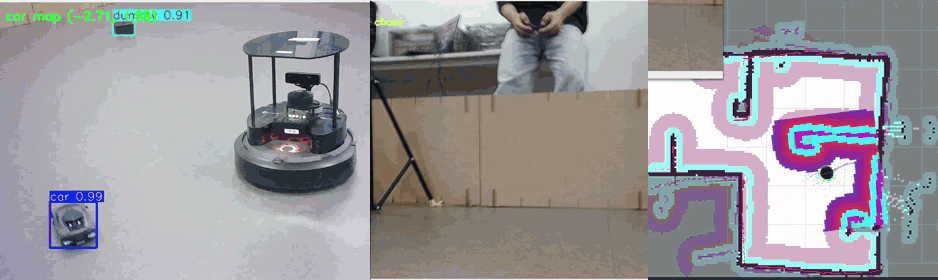

# Overwatch AMR — RC카 추적 로봇

**팀 프로젝트 · 두산로보틱스 ROKEY AI 부트캠프 · 2026.10**
📂 코드: [mi1nn/overwatch-amr](https://github.com/mi1nn/overwatch-amr) · 🇺🇸 [English](overwatch-amr.md) · ← [프로필](../README.ko.md)

  
   최종 시연, 4배속 · 고정 웹캠(왼쪽) · 로봇 OAK-D 카메라(가운데) · RViz 지도(오른쪽)

## 개요

고정 웹캠의 도움을 받아 움직이는 RC카를 찾아 따라가는 TurtleBot 4입니다. 웹캠이 YOLO로 RC카를 찾고 호모그래피로 map 좌표를 계산하면, 로봇이 Nav2로 접근한 뒤 OAK-D 카메라로 추적합니다. RC카를 놓치면 제자리에서 돌며 다시 찾습니다.

## 담당

**SLAM 지도 작성, 로봇 OAK-D 카메라용 YOLO 학습**

## 한 일

- **주행용 지도 작성.** TurtleBot 4로 SLAM을 돌려 자동 탐색 지도와 수동 조종 지도 두 개(0.05 m/px)를 만들었고, AMCL과 Nav2가 이 지도를 사용합니다.
- **로봇 카메라로 데이터셋 구축.** OAK-D 영상을 rosbag으로 녹화해 20프레임마다 한 장씩 추출하고, `car`(추적 대상)와 `dummy`(무시할 비슷한 물체) 두 클래스로 라벨링했습니다.
- **YOLO 6개 모델을 같은 조건으로 비교.** YOLOv8n/s, YOLO11n/s, YOLO26n/s를 같은 설정으로 학습하고, 같은 test 셋으로 다시 검증·비교하는 스크립트를 작성했습니다.
- **실패한 학습 원인 분석.** YOLOv8s가 21 epoch에서 조기 종료되며 mAP50-95 0.50, `dummy` 검출 0건이 나왔습니다. 2~3 epoch의 발산 때문에 회복 전에 조기 종료가 걸린 것을 찾아냈고, `patience=50`으로 다시 학습해 같은 발산 뒤 0.95까지 회복되는 것을 확인했습니다.

## 결과

6개 모델을 같은 설정(100 epoch, patience 20, 640 px, batch 16)으로 학습하고 같은 test 셋으로 평가했습니다.

| 모델 | 파라미터 (M) | Test mAP50-95 | 지연 시간 (ms/img) | |
|---|---:|---:|---:|---|
| **YOLO26n** | **2.50** | **0.977** | **3.17** | ✅ 선정 |
| YOLO11n | 2.59 | 0.964 | 3.18 | |
| YOLOv8n | 3.01 | 0.949 | 3.48 | |
| YOLO26s | 9.95 | 0.961 | 7.23 | |
| YOLOv8s (재학습, patience 50) | 11.14 | 0.953 | 6.84 | |
| YOLO11s | 9.43 | 0.928 | 6.16 | |
| YOLOv8s (1차) | 11.14 | 0.500 | 7.10 | ❌ 발산, `dummy` 전부 미검출 |

  
   지연 시간·파라미터 수 대비 test mAP50-95. 주황색 YOLOv8s는 발산한 1차 학습 결과입니다.

**비교로 확인한 것**
- **정상 학습된 모델은 모두 test 박스 24개를 전부 맞혔습니다.** `car`와 `dummy` 사이 오분류, 오탐, 미탐이 하나도 없었습니다.
- **이 데이터 규모에서는 s 모델의 이점이 없었습니다.** n 모델보다 약 2배 느리면서 정확도는 같거나 낮았고, 학습 초반에 발산하기도 쉬웠습니다.
- **로봇에는 YOLO26n이 가장 적합했습니다.** mAP50-95가 가장 높고, 파라미터가 가장 적으면서 지연 시간도 가장 짧았습니다.

> 지연 시간은 RTX 3060 Laptop GPU에서 batch 1로 잰 전처리+추론+후처리 합계이며, 로봇 PC에서는 달라집니다. test 셋이 12장(박스 24개)으로 작아서 mAP50-95가 0.01~0.02 차이 나는 것은 통계적으로 의미 있는 차이로 보기 어렵습니다.

📄 전체 분석: [학습 통계 보고서](https://github.com/mi1nn/overwatch-amr/blob/main/docs/amr/YOLO_TRAINING_REPORT.md) · [모델 비교](https://github.com/mi1nn/overwatch-amr/blob/main/docs/amr/AMR-VISION.md)

## 기술

ROS 2 Jazzy · TurtleBot 4 · SLAM · Nav2 · AMCL · OAK-D · YOLO26 · Ultralytics · Homography
