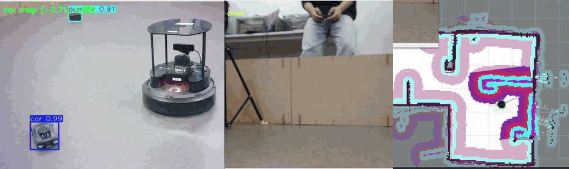
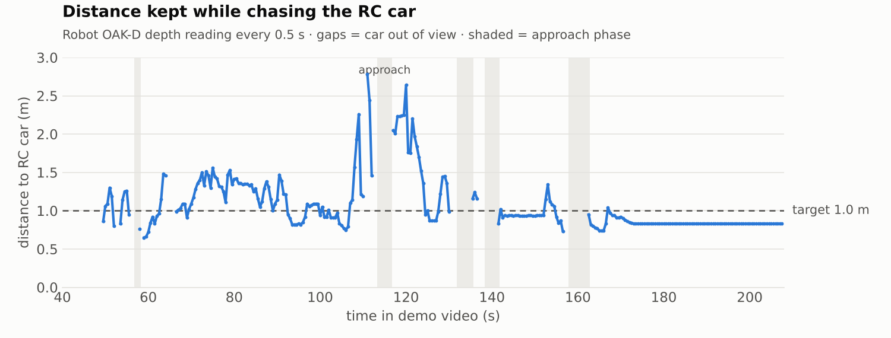
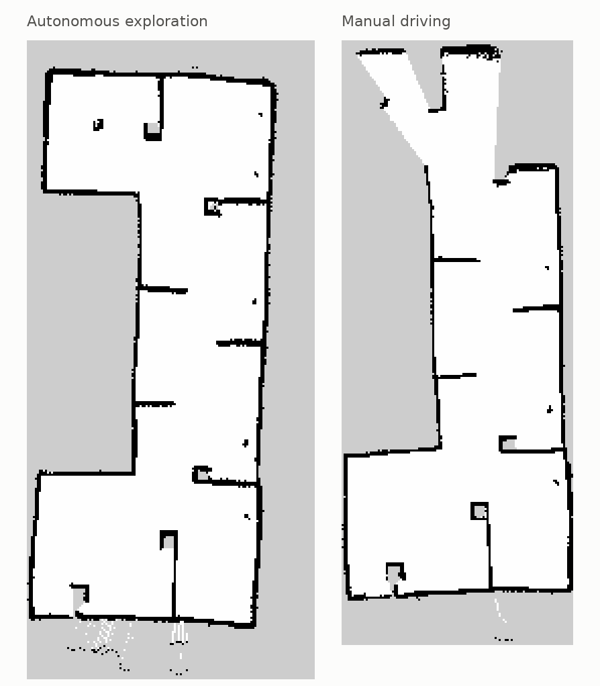

# Overwatch AMR — RC Car Chasing Robot

**Team project (3 people) · Doosan Robotics ROKEY AI Bootcamp · Oct 2026**
📂 Code: [mi1nn/overwatch-amr](https://github.com/mi1nn/overwatch-amr) · 🇰🇷 [한국어](overwatch-amr.ko.md) · ← [Profile](../README.en.md)

  
   Final demo, 4× speed · Fixed webcam (left) · Robot OAK-D camera (center) · RViz map (right)

## Overview

A TurtleBot 4 that finds and follows a moving RC car with help from a fixed webcam. The webcam locates the car with YOLO and converts it to map coordinates through a homography. The robot closes in with Nav2, then tracks the car with its OAK-D camera, and spins to search if it loses the car.

## My role

**AMR vision, webcam homography, and depth-based chase motion**

## What I did

### 1. AMR vision (robot's OAK-D camera)
- **Built the dataset from the robot's own camera.** Recorded rosbags from the OAK-D, extracted one frame every 20, and labeled two classes: `car` (target) and `dummy` (look-alike to ignore).
- **Compared six YOLO models under the same conditions** (YOLOv8n/s, YOLO11n/s, YOLO26n/s) with scripts that re-validate them on the same test set, and selected YOLO26n for the robot.
- **Diagnosed a failed training run.** YOLOv8s stopped early at epoch 21 with mAP50-95 0.50 and no `dummy` detections. I traced it to divergence in epochs 2–3 triggering early stopping before recovery; retraining with `patience=50` reproduced the divergence but recovered to 0.95.

### 2. Webcam homography (pixel → map coordinates)
- The fixed webcam only knows pixels, so I computed a homography **H** from pairs of floor points: their pixel position and their map position, taken from the robot's AMCL pose (`/amcl_pose`) or RViz.
- The detected car is mapped through **H** using the **bottom center of its bounding box** — the point touching the floor. Using the box center would shift the position by the car's height, because the homography is only valid on the floor plane.
- The calibration node reports per-point reprojection error, RANSAC inliers, and leave-one-out error so a bad calibration can be caught before driving.

### 3. Chase motion (depth camera + AMCL pose + Nav2)
Once the robot sees the car, it computes the car's position on the map and follows it at a fixed distance. I built the map of the enclosed test area myself with SLAM (once by autonomous exploration, once by manual driving, 0.05 m/px) and saved it. At runtime the robot does not map; AMCL localizes it on the saved map with the 2D lidar, and the same lidar updates Nav2's costmap, so obstacles in the path are detected while chasing.

1. **Bearing from the image.** The horizontal offset of the bounding box, together with the OAK-D's 69° horizontal field of view, gives the angle to the car.
2. **Distance from depth.** The median of a small depth window at the box center gives the distance along the optical axis, corrected by the bearing to get the true range.
3. **Car position on the map.** Combining bearing and range with the robot's AMCL-localized pose (`map → base_link`) gives the car's map coordinates.
4. **Follow at 1.0 m with Nav2.** The car's position is sent as a Nav2 goal, and the robot stops once 1.0 m of path remains, so Nav2 still plans around walls. Goals are re-sent at most every 0.5 s and only when the car moves more than 0.2 m, to avoid constant re-planning.
5. **Keep the car centered when close.** Within 1.0 m, the robot cancels the goal and rotates in place with a P-controller (gain 1.2, max 1.0 rad/s) to keep the car in the middle of the image.

## Results

### Chase performance (final demo)

<picture>
  <source media="(prefers-color-scheme: dark)" srcset="../assets/overwatch-chase-distance-dark.png">
  
</picture>

| Readings while chasing | Median distance | Middle 50% | Within 0.7–1.3 m |
|---:|---:|---:|---:|
| 266 | 0.93 m | 0.83 – 1.21 m | 79% |

- **The robot held close to the 1.0 m target** while a person moved the RC car around the arena.
- **Spikes up to 2.8 m** are moments when the car was pulled away quickly; the robot closed the gap again within a few seconds.
- **When the car stopped (from about 172 s), the robot settled at 0.83 m and held.** It stops once 1.0 m of path remains and never reverses, so it comes to rest just inside the target.

> Distances were read every 0.5 s from the depth value the follower node draws on its camera window in the demo recording, then spot-checked against the frames. This is one demo run with the car moved by hand, not a controlled benchmark.

### Maps built with SLAM

  
   Occupancy maps of the enclosed test area (0.05 m/px), built by autonomous exploration and by manual driving.

### AMR vision model comparison

Six models trained with identical settings (100 epochs, patience 20, 640 px, batch 16) and evaluated on the same test set.

| Model | Params (M) | Test mAP50-95 | Latency (ms/img) | |
|---|---:|---:|---:|---|
| **YOLO26n** | **2.50** | **0.977** | **3.17** | ✅ selected |
| YOLO11n | 2.59 | 0.964 | 3.18 | |
| YOLOv8n | 3.01 | 0.949 | 3.48 | |
| YOLO26s | 9.95 | 0.961 | 7.23 | |
| YOLOv8s (retrained, patience 50) | 11.14 | 0.953 | 6.84 | |
| YOLO11s | 9.43 | 0.928 | 6.16 | |
| YOLOv8s (first run) | 11.14 | 0.500 | 7.10 | ❌ diverged, missed every `dummy` |

  
   Test mAP50-95 vs latency and parameter count. YOLOv8s (orange) is the first, diverged run.

**What the comparison showed**
- **Every properly trained model got all 24 test boxes right**: no misclassification, false positive, or miss between `car` and `dummy`.
- **Small (s) models gave no benefit at this data scale.** They were about 2× slower than the nano (n) models with equal or lower accuracy, and were more prone to diverging early in training.
- **YOLO26n was the best fit for the robot**: the highest mAP50-95 and the lowest latency with the fewest parameters.

> Latency is preprocessing + inference + postprocessing at batch 1 on an RTX 3060 Laptop GPU; it will differ on the robot PC. The test set is small (12 images, 24 boxes), so mAP50-95 differences of 0.01–0.02 are not statistically meaningful.

📄 Full analysis (Korean): [training report](https://github.com/mi1nn/overwatch-amr/blob/main/docs/amr/YOLO_TRAINING_REPORT.md) · [model comparison](https://github.com/mi1nn/overwatch-amr/blob/main/docs/amr/AMR-VISION.md)

## Tech

ROS 2 Jazzy · TurtleBot 4 · 2D LiDAR · SLAM (mapping) · AMCL · Nav2 · OAK-D · YOLO26 · Ultralytics · Homography
